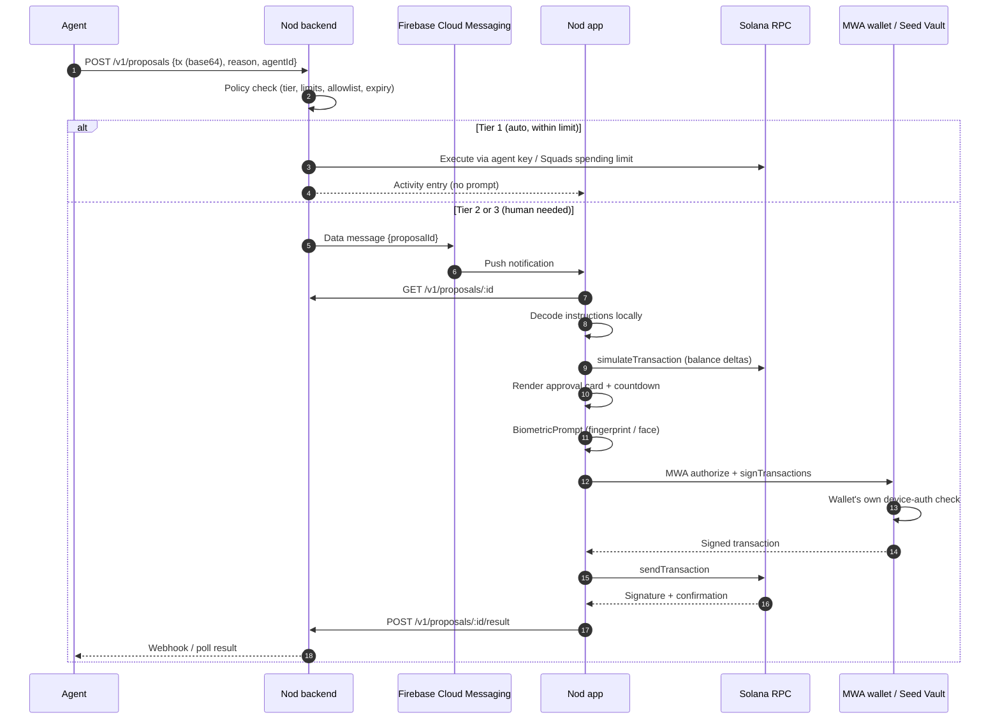
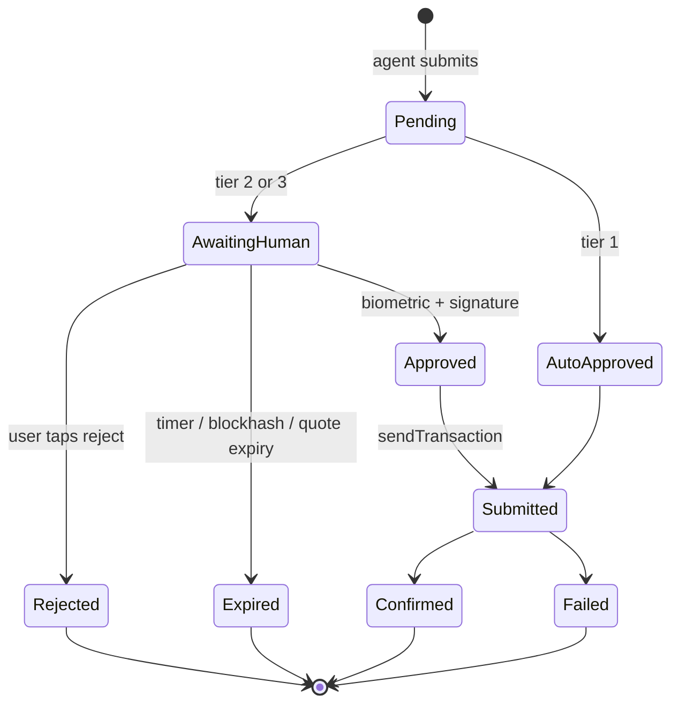

# Nod

> **Nothing moves without your Nod.**
> A mobile approval layer that keeps AI agents on a leash. Your agent proposes a Solana transaction, your phone decodes it, and you approve with your fingerprint or face.

Built for **Clock In: A Solana Mobile Hackathon** (Android, Mobile Wallet Adapter, Solana dApp Store).

---

## Table of contents

1. [The problem](#the-problem)
2. [What Nod does](#what-nod-does)
3. [Architecture](#architecture)
4. [Approval flow](#approval-flow)
5. [Solana integration](#solana-integration)
6. [Transaction decoding (the part that matters)](#transaction-decoding-the-part-that-matters)
7. [Policy tiers](#policy-tiers)
8. [Security model](#security-model)
9. [Mobile-native features](#mobile-native-features)
10. [Design and typography](#design-and-typography)
11. [Tech stack](#tech-stack)
12. [Repository structure](#repository-structure)
13. [Getting started](#getting-started)
14. [Environment variables](#environment-variables)
15. [Running the demo agent](#running-the-demo-agent)
16. [Building the APK](#building-the-apk)
17. [Demo script (3 minutes)](#demo-script-3-minutes)
18. [Status](#status)
19. [Known limitations](#known-limitations)
20. [Roadmap](#roadmap)
21. [Publishing to the Solana dApp Store](#publishing-to-the-solana-dapp-store)
22. [Hackathon criteria mapping](#hackathon-criteria-mapping)
23. [Author and license](#author-and-license)

---

## The problem

AI agents are starting to move money: paying for APIs, buying things, rebalancing portfolios, trading. Today there are two bad options:

- **Give the agent a hot key.** It's fast, but one prompt injection or bug can drain the wallet.
- **Make the human sign everything in a wallet UI.** It's safe, but the wallet shows opaque transaction bytes, so people tap "approve" without understanding what they're signing.

What's missing is a good **human-in-the-loop layer**: something that reaches you wherever you are, shows in plain language what the agent wants to do (decoded from the real transaction, not from what the agent claims), and lets you approve or reject in one biometric tap.

## What Nod does

- An agent (any script or bot) sends Nod a **proposed Solana transaction** plus a one-line reason.
- Nod's **policy engine** sorts it into a tier: auto-approve, single biometric approval, or multi-person approval.
- For anything that needs a human, Nod sends a **push notification** to your phone.
- The app **decodes and simulates the transaction locally** and shows a plain-language approval card with balance changes, the programs involved, and a countdown.
- You approve with **biometrics**. The signature happens through **Mobile Wallet Adapter**, so keys never leave your wallet (Seed Vault on a Seeker, or any MWA wallet).
- The transaction is submitted to Solana and the result appears in your activity feed.

Typical use cases: an agent paying for services, an agent trading or rebalancing, a shared team or family treasury where an agent proposes and several people decide.

---

## Architecture

```mermaid
flowchart LR
    subgraph Agent["AI agent (any script or bot)"]
        A1[Strategy / task logic]
        A2[Nod SDK<br/>propose&#40;tx, reason&#41;]
    end

    subgraph Backend["Nod backend"]
        B1[Proposal API]
        B2[Policy engine<br/>tiers + limits]
        B3[(Database<br/>proposals, policies, devices)]
        B4[Push sender<br/>FCM]
        B5[Quote / blockhash refresher]
    end

    subgraph Phone["Android app (React Native)"]
        P1[Push handler]
        P2[Local tx decoder<br/>+ simulator]
        P3[Approval card UI<br/>countdown + balance deltas]
        P4[Biometric gate<br/>BiometricPrompt]
        P5[MWA client]
        P6[Activity feed + policy screen]
    end

    subgraph Wallet["Wallet app (MWA)"]
        W1[Seed Vault on Seeker<br/>or any MWA wallet]
    end

    subgraph Solana["Solana"]
        S1[RPC node]
        S2[System / SPL Token programs]
        S3[Jupiter swap program<br/>optional]
        S4[Squads v4 multisig<br/>optional, tier 3]
    end

    A1 --> A2 --> B1
    B1 --> B2 --> B3
    B2 -->|needs human| B4
    B2 --> B5
    B4 -->|data message| P1
    P1 -->|fetch proposal| B1
    P1 --> P2
    P2 -->|simulateTransaction| S1
    P2 --> P3 --> P4 --> P5
    P5 <-->|sign request over local WebSocket| W1
    P5 -->|signed tx| S1
    S1 --> S2
    S1 --> S3
    S1 --> S4
    P5 -->|result| B1
    B1 --> P6
```



**Design rule:** the backend is a messenger and a policy gate, never the source of truth for what a transaction does. The phone decodes and simulates the exact bytes it is about to sign.

## Approval flow



### Proposal lifecycle



---

## Solana integration

Everything below is part of the submitted build unless marked **(stretch)**.

### 1. Solana Mobile Stack and Mobile Wallet Adapter

- The app uses **Mobile Wallet Adapter (MWA)** to `authorize` a wallet session and request signatures. Private keys never enter the Nod app.
- On a **Seeker**, signing is handled by **Seed Vault**, so the key lives in secure hardware and the wallet performs its own device-authentication check at signing time.
- Any MWA-compatible wallet works (for example Phantom or Solflare on a regular Android phone), which keeps the demo reproducible without a Seeker.
- Packages: `@solana-mobile/mobile-wallet-adapter-protocol-web3js` and `@solana-mobile/mobile-wallet-adapter-protocol`.
- MWA communicates over a local connection between apps on the same device, so a **real device with a wallet installed** is required. Emulator-only testing does not exercise it.

### 2. Transactions and RPC

- `@solana/web3.js` builds, deserializes, simulates, and submits transactions.
- Transactions are **versioned transactions (v0)**, which is what Jupiter returns, so address lookup tables are resolved before decoding.
- `simulateTransaction` is run on the phone with `replaceRecentBlockhash: false` and account-state return enabled, to compute **before/after balance changes** for the user's accounts.
- Confirmation uses `confirmTransaction` with the blockhash and `lastValidBlockHeight` so expiry is handled explicitly.
- A priority fee is set through the Compute Budget program when the backend builds transactions.

### 3. Programs the decoder understands

| Program | Used for | Program ID (verify before relying) |
|---|---|---|
| System Program | SOL transfers, account creation | `11111111111111111111111111111111` |
| SPL Token Program | Token transfers (`transfer`, `transferChecked`), approvals | `TokenkegQfeZyiNwAJbNbGKPFXCWuBvf9Ss623VQ5DA` |
| Associated Token Account | Creating token accounts for recipients | `ATokenGPvbdGVxr1b2hvZbsiqW5xWH25efTNsLJA8knL` |
| Compute Budget | Priority fee and compute limit | `ComputeBudget111111111111111111111111111111` |
| Memo | Reason text attached on-chain | `MemoSq4gqABAXKb96qnH8TysNcWxMyWCqXgDLGmfcHr` |
| Jupiter v6 | Token swaps (trading scenario) | `JUP6LkbZbjS1jKKwapdHNy74zcZ3tLUZoi5QNyVTaV4` |
| Squads v4 **(stretch)** | Multisig proposals, votes, spending limits | `SQDS4ep65T869zMMBKyuUq6aD6EgTu8psMjkvj52pCf` |

Program IDs are listed from memory. Confirm each against the official docs or an explorer before relying on it.

### 4. Swaps through Jupiter (trading scenario)

- The demo agent asks the Jupiter quote API for a route, then asks for the swap transaction.
- The approval card shows: amount in, **minimum amount out**, slippage, route programs, and a quote age countdown.
- Jupiter liquidity is on **mainnet**, not devnet. For the demo, either use a few dollars of real funds on mainnet, or run the swap scenario as a clearly labeled **mock** on devnet. The demo video must state which one is shown.

### 5. On-chain reasons with Memo

When a transaction is built by Nod's SDK, the agent's one-line reason can be attached as a **Memo instruction**, so the "why" is recorded in the transaction history. The approval card shows the reason, but it is labeled **"agent says"** and is never treated as verified.

### 6. Multi-approval with Squads v4 (stretch)

For large amounts, a **Squads multisig** holds the treasury:

- The agent (or backend) creates a **vault transaction proposal**.
- Each member's phone receives a push and signs an **approve vote** through MWA with their own biometric check.
- When the threshold (for example 2 of 3) is reached, the proposal can be executed.
- Proposals persist on-chain, so approvers do not have to be online at the same moment, and no durable-nonce handling is needed.
- **Spending limits** in Squads give an on-chain version of tier 1: the agent's key can spend up to a fixed amount per period without votes, enforced by the program instead of by Nod's backend.
- SDK: `@sqds/multisig`.

### 7. Network and cluster

| Component | Cluster |
|---|---|
| Core approval flow, payments | Devnet |
| Jupiter swap scenario | Mainnet (small funds) or labeled mock on devnet |
| Squads multisig (stretch) | Devnet |

---

## Transaction decoding (the part that matters)

An approval screen that repeats what the agent *claims* defeats the purpose. Nod decodes the actual bytes:

1. **Deserialize** the transaction and resolve any address lookup tables.
2. **Parse each instruction** against the known programs above into plain language, for example: "Send **25 USDC** to `7xKd…9fQ2`" or "Swap **1.2 SOL** for at least **180.4 USDC** (slippage 0.5%)".
3. **Simulate** the transaction and compute **balance deltas** for the user's accounts. Deltas are shown even when an instruction can't be decoded.
4. **Flag risks** with a visible badge:
   - Unknown program: "Cannot decode, review carefully" (default: block unless the user explicitly opts in)
   - Token delegate/approve instructions that grant spending authority
   - Setting a new authority on an account
   - Recipient not seen before
   - Amount above the agent's usual range
5. **Show agent metadata separately**, labeled "agent says: …", never mixed with decoded facts.
6. **Block expired proposals.** If the blockhash or quote is stale, the app asks the backend for a fresh transaction, then decodes and shows that new transaction from scratch.

The rule: **the phone only signs what it has decoded and simulated itself.**

---

## Policy tiers

Policies are per agent and configurable in the app.

| Tier | Condition (example defaults) | What happens |
|---|---|---|
| **1. Auto** | Amount under the daily limit, recipient on the allowlist, known programs only | Executes without a prompt. Appears in the feed. Optional silent push. |
| **2. Nod** | Over the auto limit, new recipient, or any swap | Push, decoded card, **biometric approval** |
| **3. Council** (stretch) | Above the high-value threshold | Needs M of N approvers (Squads multisig), each with their own biometric |
| **Block** | Unknown program, authority change, or amount over the hard cap | Rejected automatically, agent is told why |

Additional controls: per-agent daily spend cap, allowlist of recipients and programs, kill switch ("freeze agent") that revokes the agent's access in one tap, and a time window for approvals.

---

## Security model

**Trust assumptions**

| Component | Trusted? | Notes |
|---|---|---|
| The agent | **No** | Assumed possibly compromised or confused. Its reason text is display-only. |
| Nod backend | **Partially** | Routes proposals and enforces coarse policy. Cannot sign. Compromise should not let it move funds beyond tier 1 limits. |
| The phone app | Yes (user's device) | Decodes and simulates what it signs. |
| The wallet / Seed Vault | Yes | Holds keys. Does its own device-auth check. |

**Mitigations**

- Keys never enter the Nod app or backend (signing happens in the MWA wallet).
- Tier 1 spending is capped, and with Squads spending limits the cap is enforced on-chain.
- Replay and stale approvals are limited by blockhash and quote expiry.
- The proposal id binds to the transaction hash, so the backend cannot swap the transaction after the push was sent without the app noticing.
- Authentication between agent and backend uses per-agent API keys that can be revoked.
- Push payloads carry only a proposal id, never transaction details.

**Honest caveats:** the biometric prompt inside Nod is an app-level gate, and the cryptographic protection comes from the wallet's own signing authentication. This is a hackathon build and has not been audited.

---

## Mobile-native features

- **Push notifications** with high priority and a deep link into the approval card
- **Biometric approval** via the Android system prompt, with the screen lock (PIN, pattern or password) as a fallback when no biometric is enrolled (the app never sees biometric data; the only permission is `USE_BIOMETRIC`)
- **Haptic feedback** on approve, reject, and expiring countdown
- **Lock-screen friendly** notifications with an expiry countdown
- **Mobile Wallet Adapter** signing with a wallet on the same device
- **Seed Vault** support on Seeker
- **Share/QR** for pairing an agent with the app (scan to link)

---

## Design and typography

Nod's interface is built so that the **facts** (amounts, addresses, countdowns) read differently from the **conversation** (labels, headings, actions).

### Fonts

| Font | Used for | Why |
|---|---|---|
| **Plus Jakarta Sans** | Headings, body text, buttons, labels, notification copy | Friendly, highly legible, and gives the app a calm, trustworthy tone |
| **Geist Mono** | Amounts, token balances, wallet addresses, signatures, program IDs, the countdown | Monospaced digits align and don't shift while a timer runs, and mono text signals "this is raw, verifiable data" |

Rule of thumb: **if the user could copy it, compare it, or verify it on an explorer, it is set in Geist Mono.** Anything the agent wrote ("agent says: ...") uses Jakarta and is visually separated from the decoded facts.

### Loading and weights

- Static `.ttf` files are bundled in `app/assets/fonts/` and loaded with `expo-font` (embedded at build time through the config plugin, so there is no fallback-font flash on first launch).
- Variable font files are avoided because React Native handles them unreliably.
- Each weight is registered under its own family name, because Android ignores `fontWeight` for custom fonts:

```ts
// app/src/theme/fonts.ts
export const fonts = {
  jakarta: {
    regular: "Jakarta-Regular",
    semibold: "Jakarta-SemiBold",
    bold: "Jakarta-Bold",
  },
  mono: {
    regular: "GeistMono-Regular",
    medium: "GeistMono-Medium",
  },
} as const;
```

### Type scale (starting point)

| Role | Font | Size / weight |
|---|---|---|
| Screen title | Jakarta | 24 / Bold |
| Card heading ("Swap 1.2 SOL") | Jakarta | 18 / SemiBold |
| Body and labels | Jakarta | 14–15 / Regular |
| Primary amount | Geist Mono | 28 / Medium |
| Addresses and IDs | Geist Mono | 13 / Regular (truncated middle: `7xKd…9fQ2`) |
| Countdown | Geist Mono | 16 / Medium |

### Design principles

- **Clarity over decoration.** The approval card is the product, so nothing competes with the amount, the recipient and the expiry.
- **Risk is always visible.** Unknown programs, new recipients and authority changes get a distinct badge, never hidden in a details view.
- **Deliberate approval.** Approving uses an intentional gesture plus a haptic, so it can't be done by accident from the lock screen.
- **Motion with a purpose.** Animation is used for the expiry countdown and state changes (approved, rejected, expired), not for decoration.
- **Dark and light themes** follow the system setting.

---

## Tech stack

| Layer | Choice |
|---|---|
| Mobile app | React Native (Expo dev build or bare), TypeScript, Android only |
| Wallet | `@solana-mobile/mobile-wallet-adapter-protocol-web3js` |
| Solana | `@solana/web3.js`, `@solana/spl-token`, `@sqds/multisig` (stretch) |
| Biometrics | `expo-local-authentication` (Android `BiometricPrompt`) |
| Fonts | Plus Jakarta Sans (UI), Geist Mono (data), loaded with `expo-font` |
| Animation | `react-native-reanimated` (optionally Moti) |
| Push | Firebase Cloud Messaging |
| Backend | Node.js, TypeScript, Fastify |
| Database | SQLite (demo) or Postgres |
| Agent SDK | Small TypeScript package: `propose(tx, reason)` |
| Swaps | Jupiter quote and swap API |

Note: MWA and push need native modules, so **Expo Go will not work**. Use a development build.

---

## Repository structure

```
nod/
├── app/                    # React Native Android app
│   ├── src/
│   │   ├── screens/        # Approvals, ProposalCard, Activity, Policy, Pairing
│   │   ├── solana/         # mwa.ts, decode.ts, simulate.ts, programs/
│   │   ├── push/           # FCM handlers, deep links
│   │   ├── security/       # biometric.ts
│   │   └── api/            # backend client
│   └── android/
├── backend/
│   ├── src/
│   │   ├── routes/         # proposals, devices, policies
│   │   ├── policy/         # tier engine
│   │   ├── push/           # FCM sender
│   │   ├── solana/         # quote refresh, blockhash, execution
│   │   └── db/
│   └── .env.example
├── sdk/                    # Agent SDK: propose(), pollResult()
├── demo-agent/             # Payment agent and swap/rebalance agent
├── docs/                   # Pitch deck, diagrams, screenshots
└── README.md
```

---

## Getting started

### Prerequisites

- Node.js 20+
- Android Studio with SDK and a **real Android phone** (USB debugging on, a fingerprint or face enrolled)
- An MWA-compatible wallet installed on the phone (Phantom, Solflare, or Seed Vault on a Seeker)
- A Firebase project with Cloud Messaging enabled (`google-services.json`)
- A Solana RPC URL (devnet works with the public endpoint; a Helius or similar key is more reliable)
- Devnet SOL for the wallet and the agent key (`solana airdrop` or a faucet)

### 1. Clone and install

```bash
git clone https://github.com/anbusan19/nod.git
cd nod
npm install            # if using workspaces; otherwise install in app/, backend/, sdk/ separately
```

### 2. Start the backend

```bash
cd backend
cp .env.example .env   # fill in values
npm run dev            # http://localhost:3000
```

For the phone to reach it, use your machine's LAN IP, or a tunnel such as ngrok.

### 3. Run the app on your phone

```bash
cd app
npx expo prebuild --platform android
npx expo run:android --device
```

Put `google-services.json` in `app/android/app/` before building.

### 4. Pair the phone

1. Open the app and connect your wallet (MWA authorize).
2. Register for push when prompted.
3. Open **Pairing** to show a QR code, then run the demo agent with that pairing code.

---

## Environment variables

`backend/.env`

```
PORT=3000
SOLANA_CLUSTER=devnet
SOLANA_RPC_URL=https://api.devnet.solana.com
FIREBASE_SERVICE_ACCOUNT_JSON=./firebase-service-account.json
DATABASE_URL=file:./nod.db
AGENT_API_KEY_SALT=change-me
JUPITER_API_URL=https://quote-api.jup.ag/v6      # confirm the current endpoint in Jupiter's docs
DEFAULT_AUTO_LIMIT_USD=5
DEFAULT_HARD_CAP_USD=500
PROPOSAL_TTL_SECONDS=90
```

`app/.env`

```
EXPO_PUBLIC_API_URL=http://<your-lan-ip>:3000
EXPO_PUBLIC_SOLANA_CLUSTER=devnet
EXPO_PUBLIC_SOLANA_RPC_URL=https://api.devnet.solana.com
```

`demo-agent/.env`

```
NOD_API_URL=http://<your-lan-ip>:3000
NOD_AGENT_KEY=<issued during pairing>
SOLANA_RPC_URL=https://api.devnet.solana.com
```

Never commit `.env` files, service-account JSON, or keypairs.

---

## Running the demo agent

```bash
cd demo-agent

# Payment agent: proposes small and large payments throughout the run
npm run payments

# Trading agent: rule-based rebalance (e.g. if allocation drifts more than 5%)
npm run trader
```

The trading agent uses a deliberately simple rule. Nod demonstrates the **approval layer**, not a profitable strategy, and no performance claims are made.

Example SDK usage:

```ts
import { Nod } from "@nod/sdk";

const nod = new Nod({ apiUrl: process.env.NOD_API_URL!, agentKey: process.env.NOD_AGENT_KEY! });

const proposal = await nod.propose({
  transaction: serializedTxBase64,
  reason: "Rebalance: SOL is 12% above target allocation",
});

const result = await nod.waitForResult(proposal.id); // approved | rejected | expired | confirmed
```

---

## Building the APK

```bash
cd app/android
./gradlew assembleRelease
# output: app/android/app/build/outputs/apk/release/app-release.apk
```

Sign the release build with your own keystore. A signed APK is also required later for dApp Store publishing. Install on a device with `adb install app-release.apk` and test it there before submitting.

---

## Demo script (3 minutes)

| Time | What is shown |
|---|---|
| 0:00–0:20 | **Problem:** agents move money; hot keys are dangerous, wallet UIs are opaque. One-line pitch: "Nothing moves without your Nod." |
| 0:20–0:45 | **Tier 1:** the agent makes a small payment, it auto-executes and appears in the feed. |
| 0:45–1:30 | **Tier 2:** the agent proposes a larger payment. Push arrives on the lock screen, the card shows decoded details and balance changes, and the countdown runs. Biometric prompt, wallet signs, devnet confirmation. |
| 1:30–2:15 | **Trading scenario:** the agent proposes a swap with minimum-out and slippage shown. Show a risk badge on a tampered or unknown-program proposal being blocked. |
| 2:15–2:40 | **Council (if built):** a large transaction needs 2 of 3 approvals, second phone approves, execution. Otherwise show policy settings and the freeze-agent button. |
| 2:40–3:00 | **Close:** architecture in one slide, what is on-chain vs off-chain, roadmap. State clearly what is real and what is mocked. |

Tips: record on the real device, show the push on the lock screen, and show an explorer link for the confirmed transaction.

---

## Status

Update this table honestly before submitting.

| Feature | Status |
|---|---|
| MWA authorize + sign on a real device | [x] confirmed on devnet (Phantom, OPPO CPH2213) |
| FCM push to the device | [ ] code written, needs google-services.json |
| Local decoder: SOL and SPL transfers | [x] unit-tested |
| Simulation + balance deltas | [x] working on device |
| Biometric gate | [x] working on device (screen-lock fallback) |
| Tier 1 / Tier 2 policy engine | [x] tier 2 working end to end; tier 1 does not execute yet |
| Activity feed | [x] |
| Demo payment agent | [x] working against devnet |
| Jupiter swap decoding | [ ] |
| Squads multisig (tier 3) | [ ] stretch |
| Squads on-chain spending limits | [ ] stretch |
| dApp Store listing | [ ] after winners announced |

## Known limitations

- Hackathon prototype, **not audited**. Do not use with real funds beyond small test amounts.
- Devnet by default; Jupiter swaps need mainnet liquidity or a labeled mock.
- The decoder covers a fixed set of programs. Everything else is flagged, not interpreted.
- Tier 1 enforcement is only trust-minimized when backed by Squads spending limits; otherwise it relies on the backend.
- Push delivery depends on Firebase and phone battery settings.
- Wallets may rewrite a transaction before signing (Phantom adds compute-budget instructions). Nod verifies the signed transaction against the reviewed one and only tolerates added compute-budget and Lighthouse instructions, with a priority-fee cap.
- Android only.

## Roadmap

- Squads multisig and on-chain spending limits as the default treasury
- More program decoders (lending, staking, perps)
- Policy-as-code per agent, with simulation-based rules ("never reduce my SOL balance by more than X")
- iOS and hardware-key approvers
- Agent reputation and per-agent audit exports
- SKR integration for the Seeker ecosystem

---

## Publishing to the Solana dApp Store

Winners must publish within 30 days of the announcement. Rough path:

1. Produce a signed release APK.
2. Prepare the listing assets (icon, screenshots, description, publisher details).
3. Follow the current Solana dApp Store publishing guide and CLI for the submission process, since steps change over time.

---

## Hackathon criteria mapping

| Criterion (25% each) | How Nod addresses it |
|---|---|
| **Stickiness and PMF** | Daily agent activity creates regular approvals; activity feed, per-agent policies, daily summary, and a freeze button give people a reason to open the app. |
| **User experience** | Push → decoded card → one biometric tap. Countdown, haptics, plain-language summaries, risk badges. |
| **Innovation / X-factor** | A mobile human-in-the-loop layer for AI agents that decodes real transactions locally instead of trusting the agent's description. |
| **Presentation and demo** | One-line pitch, three clear tiers, real-device demo with explorer links, honest labeling of what is mocked. |

Also covered: **Solana Mobile Stack + MWA**, Android APK, meaningful Solana interaction, mobile-first design.

---

## Author and license

Built by **Anbu Srinivasan** ([@anbusan19](https://github.com/anbusan19)).

License: MIT (add a `LICENSE` file).